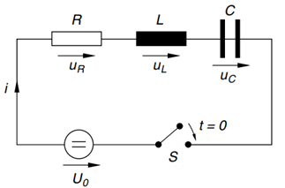

# RLC Series Circuit Simulation (Simulink)

A Simulink model analyzing the transient step response of a series RLC circuit when switched onto a DC voltage source $U_0$ at $t = 0$.

---

## Circuit Overview & Math

Applying Kirchhoff's Voltage Law (KVL) around the loop yields the governing integro-differential equation for the current $i(t)$:

$$R \cdot i(t) + L \frac{di(t)}{dt} + \frac{1}{C} \int_{0}^{t} i(\tau) \, d\tau = U_0$$

Differentiating with respect to time gives the standard second-order ODE for loop current:

$$L \frac{d^2 i(t)}{dt^2} + R \frac{di(t)}{dt} + \frac{1}{C} i(t) = 0$$

---

## Component Parameters

| Parameter | Symbol | Value |
| :--- | :--- | :--- |
| **Resistance** | $R$ | $100\ \Omega$ |
| **Inductance** | $L$ | $160\ \text{H}$ |
| **Capacitance** | $C$ | $16\ \mu\text{F}\ (16 \times 10^{-6}\ \text{F})$ |
| **Source Voltage** | $U_0$ | $15\ \text{V}$ |

---
